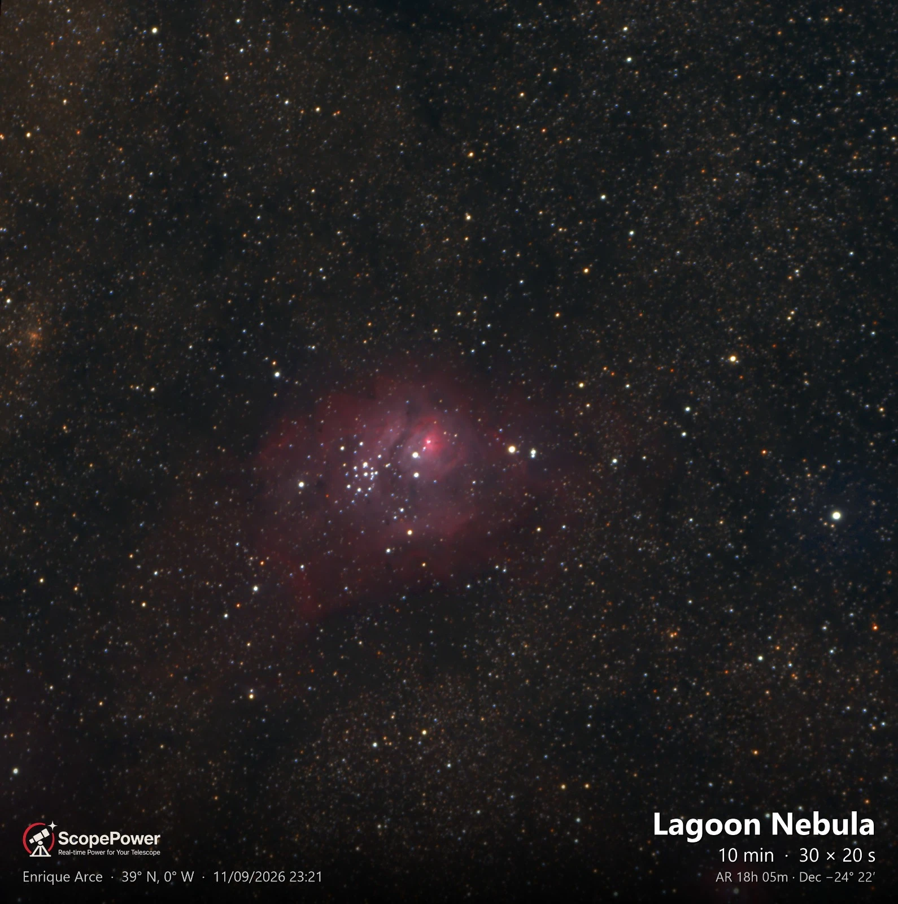
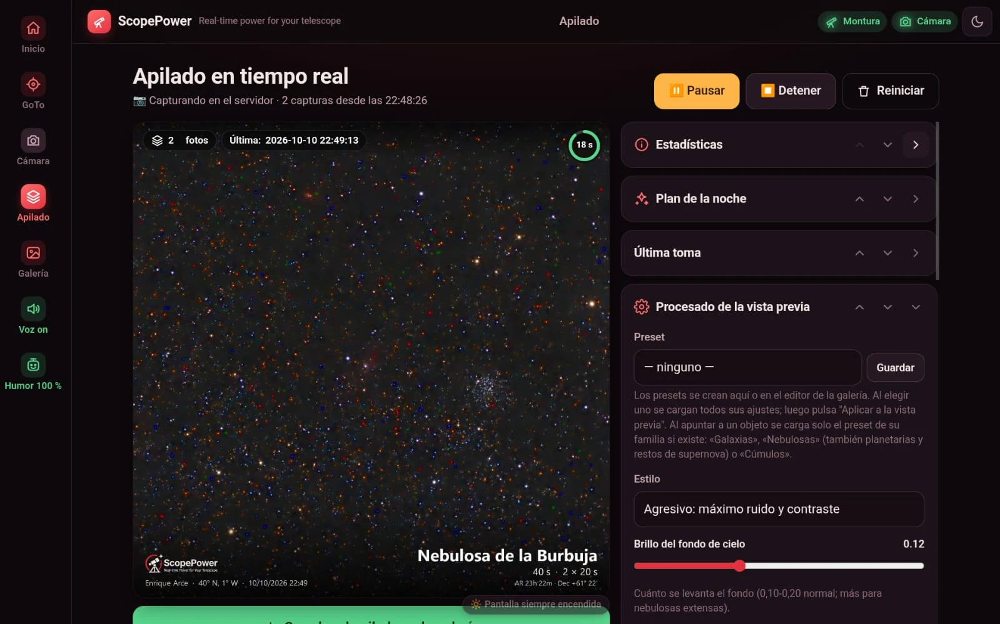
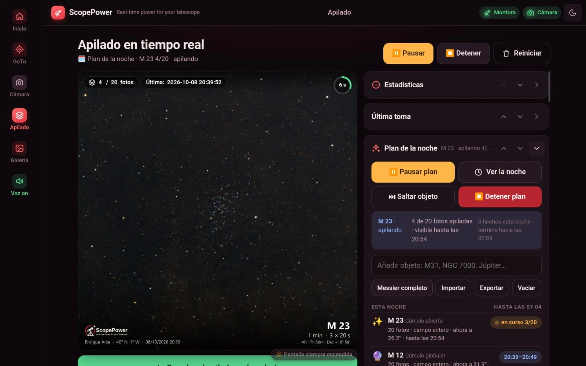
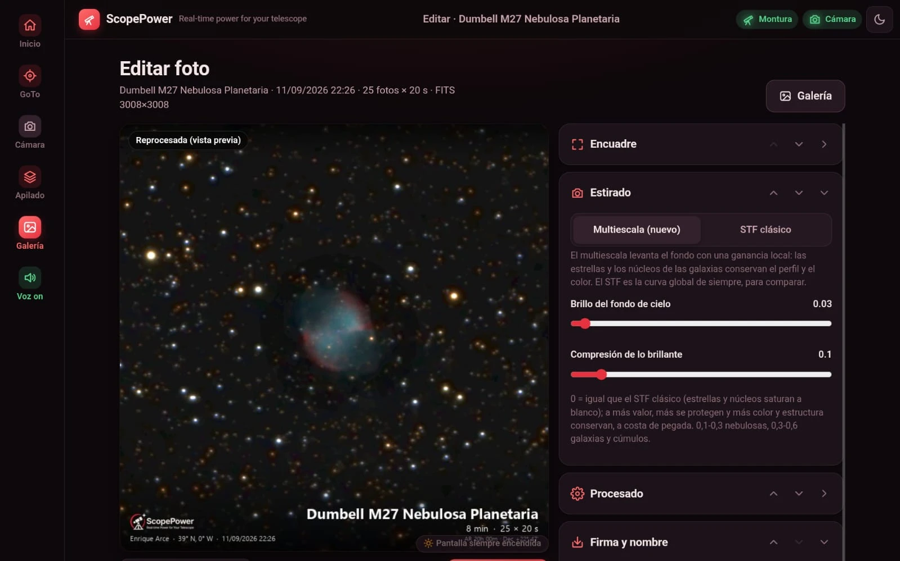
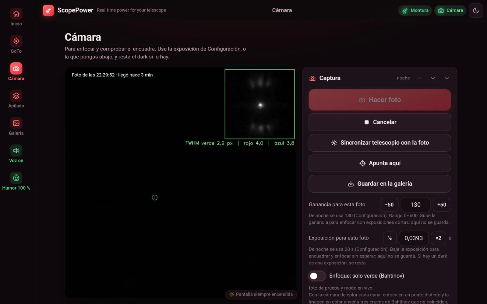
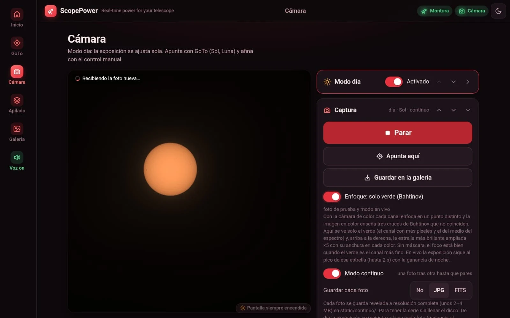
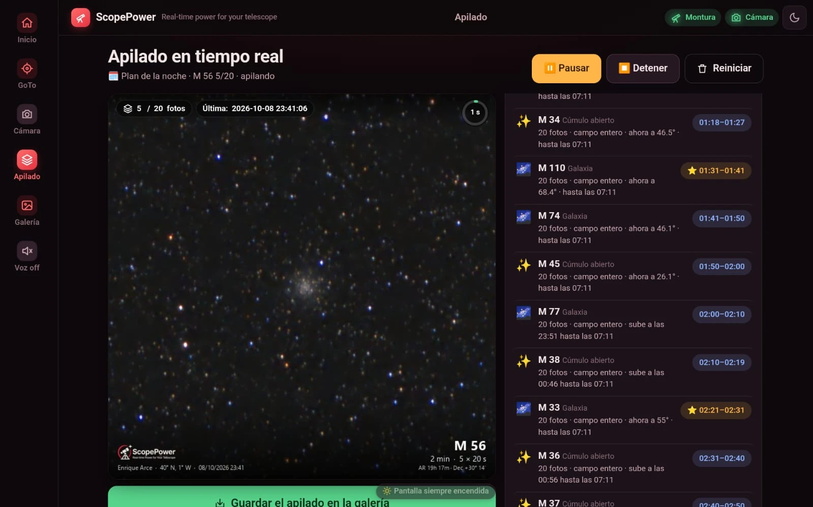
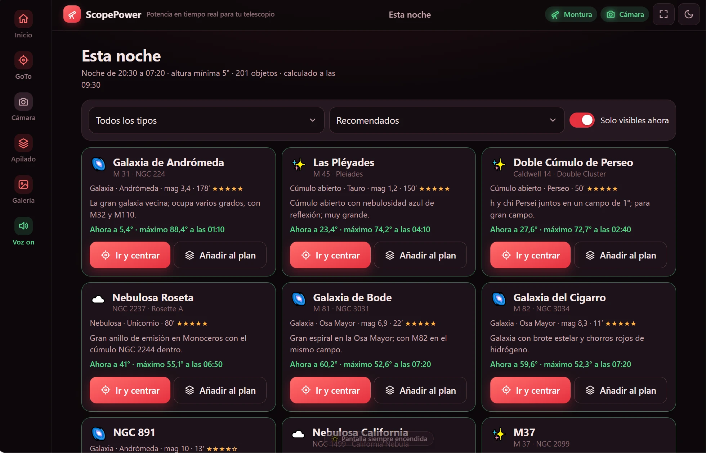
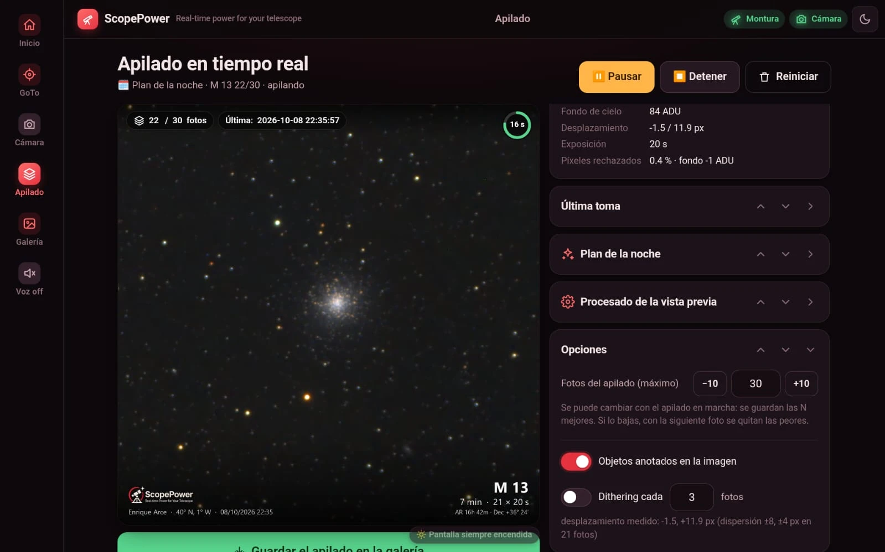

# ScopePower

*[Leer en español](README.md)*

Telescope control and real-time photo stacking from your phone. A mini PC next to the mount runs
a web server (Flask) and talks to the mount and the camera through ASCOM or the manufacturer's
native SDK; from a phone or tablet on the same Wi-Fi you point, focus, stack and process without
touching the PC.

A personal project, tested in the field with a Sky-Watcher AZ GoTo mount, an Evoguide 50 and a
Player One Saturn-C camera. The app speaks **English and Spanish** (screens and PC voice); the
code, comments and commit messages are in Spanish.



| Live stacking | Night plan |
|---|---|
|  |  |
| **Gallery editor** | **Focusing with a Bahtinov mask** |
|  |  |
| **Daytime camera: the Sun** | **Stacking statistics and options** |
|  |  |
| **Tonight: what to observe today** | **Night plan schedule** |
|  |  |

The screenshots show the Spanish interface. More in [docs/capturas](docs/capturas).

## What it does

- **GoTo by name or by voice** (“go to M31”), with a local catalog (OpenNGC, HYG, own aliases) and
  automatic plate-solving centering with ASTAP after every GoTo.
- **Live stacking**: each frame is aligned and added while capturing, rejecting bad frames, with
  library darks and flats, plane and satellite trail detection and multiscale stretching.
- **Gallery and editor**: processing, crop, rotation and mirror, deconvolution, color calibration
  from the stars, NGC/IC object annotations and comet compositing.
- **Offline planetarium** (Celestia Atlas engine) showing the telescope position and the camera
  framing; “Tonight” suggests what to observe and the **night plan** chains objects on its own.
- **Special modes**: tiled mosaics, stacking on the comet nucleus, tracking of moving objects with
  video, daytime imaging and guiding on the disk of the Sun or the Moon, timelapse.
- **Camera**: test shot, live mode, assisted focusing (Bahtinov and daytime), darks and flats, a
  calibration library by exposure, gain and binning.
- **Mount**: speed pad, multi-point alignment, altitude limits, parking, a sidereal tracking
  watchdog, direct UDP access to the SynScan Wi-Fi module as well as ASCOM.
- **Voice announcements** on the PC (with an adjustable humor level), IP announcement at startup,
  low disk space warning and its own Wi-Fi hotspot for the field.

## Language

The first step of the setup wizard asks for the language, and it can be changed at any time in
**Settings > Language** (or with `[Interfaz] idioma = en` in `config.ini`). It applies to every
phone and tablet connected and to the PC voice.

- **PC voice**: ScopePower picks the first English voice installed in Windows (David and Zira come
  with Windows). If you choose a voice in Settings > Voice announcements, that one is used as long
  as it is an English voice. Voices added from Windows Settings > Time & language > Speech become
  visible to ScopePower after running `herramientas\activar_voces_windows.bat` as administrator.
- **Voice commands** in the browser: “go to” followed by an object name or catalog number
  (M 31, NGC 7000, Andromeda Galaxy). Natural sentences, popular names that only exist in the
  Spanish alias list and dictating coordinates are not supported in English yet.
- **Object descriptions** and constellation texts have English versions; anything still missing
  falls back to Spanish.

Translations live in `traducciones/en/LC_MESSAGES/scopepower.po`. Corrections are very welcome:
see [CONTRIBUTING.md](CONTRIBUTING.md#textos-de-la-interfaz-y-traducción).

## Requirements

- Windows 10 or 11 (it uses COM, ASCOM and the Windows voice; it does not run on Linux or macOS).
- [ASCOM Platform 7](https://ascom-standards.org) and the ASCOM driver for your mount and camera.
  For a SynScan mount you also need Sky-Watcher's SynScan Pro app.
- [ASTAP](https://www.hnsky.org/astap.htm) with a star database (D05, D20 or D50). The installer
  downloads it if missing.
- Python 3.11. The installer installs it if it is not there.
- A phone or tablet on the same network as the PC. Nothing to install on the phone: it is a web page.

Tested cameras: Player One Saturn-C through ASCOM and through the native SDK. ZWO ASI, QHYCCD,
the ToupTek family (Altair, Ogma, RisingCam, SVBony, Omegon, MallinCam) and DirectShow webcams are
supported but untested with real hardware. If you have one and try it, please open an *issue*.

## Installation in three steps

1. Download or clone the repository on the PC that will sit next to the telescope.
2. Run `instalar_scopepower.bat` (it asks for administrator rights): it installs Python, creates
   its own environment in `%LOCALAPPDATA%\ScopePower`, opens port 5000 in the firewall, installs
   ASTAP if missing and creates the desktop shortcut.
3. Start ScopePower from the shortcut. The first time it opens the PC's browser to create the user
   (choose English at the top right) and launches the setup wizard (language, focal length, mount,
   camera, ASTAP, location). Then, from your phone, open the address the PC reads out over its
   speaker.

The details (drivers, voices, automatic start when the mini PC boots, updating the field PC) are
in [INSTALACION.md](INSTALACION.md), in Spanish.

## Trying it without a telescope or camera

ASCOM Platform includes simulators. In `config.ini` set:

```ini
[Dispositivos]
driver_telescopio = ASCOM.Simulator.Telescope
driver_camara = ASCOM.Simulator.Camera
exposicion_captura = 1
```

That is enough to go through the whole interface, GoTo, capture and stack synthetic frames.
Plate solving needs real sky images, so automatic centering will fail with the camera simulator
(that is expected). For object tracking there are also a fake mount and camera written in Python
(`[Seguimiento] simulador = true`).

For development without touching the installation you use at night, run the app from a copy of
the folder with its own `config.ini`: the app writes results to `static/`, `capturas/` and `datos/`.

## How it is built

| Part | Where |
|---|---|
| Web server and routes | `ScopePower.py` (Flask) |
| Mount (ASCOM and direct UDP) | `hardware.py`, `montura_ejes.py`, `aparcado.py`, `alineacion.py` |
| Cameras through native SDKs | `camara_sdk.py`, `camara_nativa.py`, `camara_zwo.py`, `camara_qhy.py`, `camara_toupcam.py`, `camara_webcam.py` |
| Stacking and processing | `apilado.py`, `apilado_incremental.py`, `procesado.py`, `darks.py`, `flats.py`, `rastros.py` |
| Plate solving and centering | `centrado.py`, `orientacion_camara.py`, `rotacion_camara.py` |
| Planetarium and catalogs | `static/atlas/`, `catalogo_offline.py`, `esta_noche.py`, `plan_sesion.py` |
| Special modes | `mosaico.py`, `cometa.py`, `seguimiento.py`, `disco.py`, `foto_dia.py`, `vivo_dia.py` |
| Interface | `templates/`, `static/css/`, `static/js/` |
| Language and translations | `idioma.py`, `static/js/i18n.js`, `traducciones/` |
| Test and measurement tools | `herramientas/` |

The configuration lives in `config.ini` (template in `config.example.ini`) and the secrets (FTP
password, Astrometry.net key, session key) in `secretos.ini`; neither goes into git. The log is in
`logs/scopepower.log` and is always written in Spanish.

## Security

ScopePower is meant for a local network (the field Wi-Fi or your home network). It listens on all
the PC's interfaces with a user and password, but without HTTPS: **do not expose it to the
Internet** or put it behind an open port on your router.

## Contributing

*Issues* and *pull requests* are welcome, in English or Spanish: how to set up the environment,
test without equipment and what to attach to a bug report is in [CONTRIBUTING.md](CONTRIBUTING.md).
Code and comments are written in Spanish. The changes in each version are in
[CHANGELOG.md](CHANGELOG.md).

## License

ScopePower is distributed under the **GNU GPL v3** license (see [LICENSE](LICENSE)).

It includes third-party components with their own licenses:

- `client.py`: Astrometry.net client, © Dustin Lang, 3-clause BSD license.
- `static/atlas/`: Celestia Atlas planetarium engine (MIT), Astronomy Engine (MIT), HYG v4.1 star
  catalog (CC-BY-SA 4.0), OpenNGC (CC-BY-SA 4.0), comet elements from the Minor Planet Center and
  constellation lines from Stellarium. Details in `static/atlas/ORIGEN.md` and
  `static/atlas/THIRD_PARTY_NOTICES.md`.
- `catalogo_objetos.csv` and `catalogo_objetos_en.csv`: coordinates and magnitudes derived from
  OpenNGC (Mattia Verga, CC-BY-SA 4.0); names and descriptions are our own.
- `info_objetos/` and the constellation texts in `constelaciones/`: summaries from Wikipedia
  (CC-BY-SA 4.0), downloaded by the app itself.

Catalog data keep their CC-BY-SA license even though the code is GPL.
